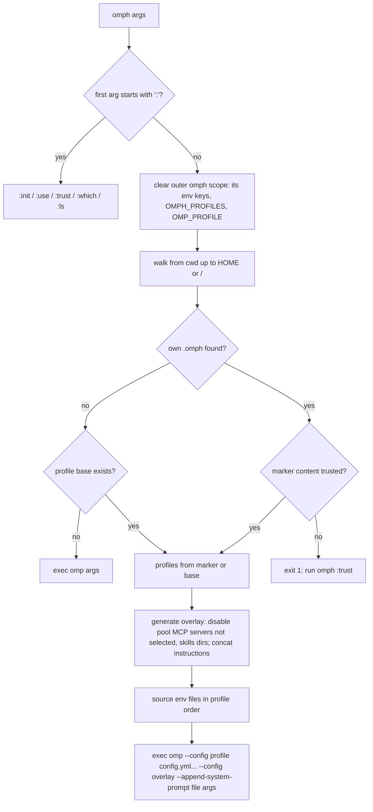

# Architecture

`bin/omph` is one bash script (needs `jq`). It never switches OMP profile (`OMP_PROFILE`): every run uses the global `~/.omp/agent`, so logins and sessions are shared. Per run it passes OMP a generated `--config` overlay and an `--append-system-prompt` file built from the selected [[profiles]]. Commands: [[usage]].

## How composition works

- **MCP**: all servers live in one pool, the global `~/.omp/agent/mcp.json` (add them with omp's `/mcp add`). The overlay lists every pool server no selected profile names under `disabledExtensions: ["mcp:<name>"]`. A profile naming a server missing from the pool is an error.
- **Skills**: each selected profile's `skills/` goes into `skills.customDirectories`, in profile order (first wins a name clash).
- **Instructions**: `instructions.md` files are concatenated in profile order and appended to the system prompt.
- **Settings**: a profile `config.yml` (e.g. `modelRoles`) is passed as its own `--config`; later profiles win. `omph` owns `disabledExtensions` and `skills.customDirectories` (OMP replaces arrays across layers), so profiles may not set them, and a global value is replaced for `omph` runs.
- **Secrets**: `env` files are sourced in profile order (later wins) and exported.

## Security

- The marker is data: strict `profiles = a, b`; names must match `[A-Za-z0-9_-]+`. It is never sourced.
- Trust list (like direnv): `~/.config/omph/trusted` holds `sha256 path` of approved markers. `omph :use` writes and trusts; a cloned or edited marker is refused until `omph :trust`. Markers not owned by you are ignored; symlinked markers are refused (they would borrow another marker's trust).
- `base` applies in every unmarked directory, including untrusted clones: keep secrets out of `base`.
- Nested runs start clean: shells spawned by omp inherit its environment, so every run first unsets the outer profiles' `KEY=VALUE` names (recorded in `OMPH_ENV_KEYS`; `PATH`/`HOME` kept).
- Not isolated: MCP servers from a repo's own config (`.omp/mcp.json`, `.mcp.json`, `opencode.json`, `.cursor/`, …) and plugins still load; they belong to the repo you chose to trust.
- Repo entries override pool entries of the same name: an unselected name is still disabled (the deny-list matches by name), but a repo entry with `enabled: false` hides a selected pool server. Remove such duplicates from the repo.
